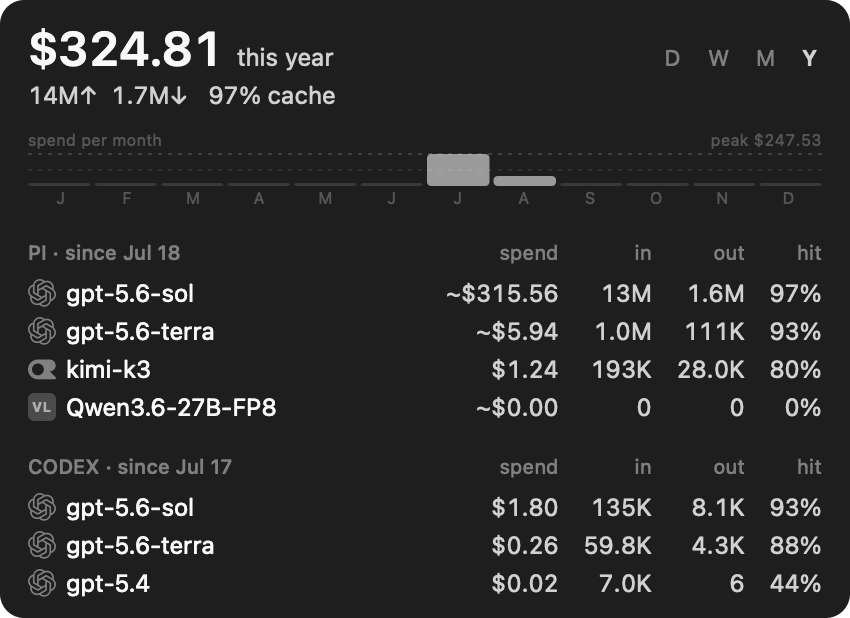

# Token Bar

A macOS menu bar app that tracks AI usage across coding tools: estimated spend,
input and output tokens, and cache hit rate.

<p align="center">
  
</p>

## Homebrew

### Install

```sh
brew install shrivara/tap/token-bar
brew services start token-bar
```

The service starts Token Bar now and at login.

Token Bar supports **macOS 14 and later**. Homebrew uses a compatible prebuilt
bottle when available; otherwise, it builds from source, which requires the
Xcode Command Line Tools.

For a standalone app bundle, see [Build from source](DEVELOPMENT.md#build-from-source).

### Update

```sh
brew update
brew upgrade token-bar
brew services restart token-bar
```

Right-click the menu bar item to check the running version. Homebrew installs
released versions, not unreleased changes on `main`.

## Using Token Bar

- **Left-click** the menu bar item to open the dashboard. Choose a day, week,
  month, or year view to see totals, a spend graph, and per-model usage.
- **Right-click** to choose the machine, visible metrics, panel options, theme,
  and period range, or to quit.
- Use **Period Range → Calendar** for the current week, month, or year, or
  **Relative** for the last 7 days, 30 days, or 12 months.
- Use **Theme → System** to follow the macOS appearance, or choose a built-in
  light or dark theme.
- Click the camera button to copy a dashboard screenshot to the clipboard.

### Animated cat

The animated cat on the spend graph is enabled by default. Toggle it under
**Show in Panel → Animated Cat**. Saved disabled settings are preserved across
upgrades.

The menu-bar cat is controlled separately. Set **Show in Menu Bar → Cat Peek Limit…**
to show it when the selected machine's estimated spend for today reaches your
chosen USD amount. Leave the field blank to turn it off.

### Projects and sessions

Enable **Show in Panel → Projects & Sessions**, under **Experimental**, to group
usage across tools by Git root or working directory and see the highest-usage
sessions. Folder icons open projects in Finder; session names resume sessions
in Terminal using the corresponding CLI, which must be installed.

This feature is available only for **Main Machine**, not SSH machines.

## Supported tools

Token Bar reads these paths in the user's home directory, either on this Mac
or on the selected SSH host:

| Tool | History location |
| --- | --- |
| [Claude Code](https://claude.com/claude-code) | `~/.claude/projects/**/*.jsonl` |
| [Codex](https://developers.openai.com/codex/) | `~/.codex/sessions/**/*.jsonl` |
| [OpenCode](https://opencode.ai) (1.x and 2.x) | `~/.local/share/opencode/opencode.db` |
| [pi](https://github.com/earendil-works/pi) | `~/.pi/agent/sessions/**/*.jsonl` |

Local history is watched for changes, with a 60-second fallback refresh. Custom
history directories are not currently configurable in Token Bar.

## Remote machines

Use **Machine → Add SSH Machine…** to monitor another machine. Enter an SSH
configuration alias, such as `work-server`, or a destination such as
`user@hostname`. Configure custom ports and keys in `~/.ssh/config`.

Before adding a machine:

1. Connect from Terminal to verify the host key and set up key-based access.
2. Make sure SSH can authenticate without an interactive prompt, for example
   through an SSH agent.
3. Make sure `python3` is available on the remote host in a non-interactive SSH
   session. Token Bar does not need to be installed there.

Token Bar refreshes the selected SSH machine every 60 seconds. Local and remote
usage are shown separately, not combined, and periods use this Mac's time zone.
If a connection fails after a successful sync, cached totals remain visible and
are marked as stale. Use **Machine → Refresh Now** to retry or
**Connection Details…** to inspect the error.

Remote history is cached under `~/Library/Caches/Token Bar/Remote Machines/`.
These files can include session text, not just usage totals. Use
**Machine → Remove Selected Machine…** to remove the saved connection and its
local cache; this does not delete history on the remote host.

## Pricing and privacy

- Spend is estimated API-equivalent cost in USD, not your subscription bill.
- Rates come from a bundled [models.dev](https://models.dev/) snapshot, including
  mode-specific prices such as `-fast`. Token Bar does not fetch live prices.
- Provider and model fallback matches are estimates marked `~`. Models with no
  matching price contribute `$0` and are also marked `~`; this does not mean the
  provider charges nothing for them.
- Usage is processed locally. Optional SSH monitoring transfers history to this
  Mac; Token Bar does not upload usage data or send telemetry.

## Development

See [Development](DEVELOPMENT.md) for builds, tests, and pricing updates, and
[Releasing Token Bar](RELEASING.md) for publishing a version and updating Homebrew.

## License

[MIT](LICENSE).
